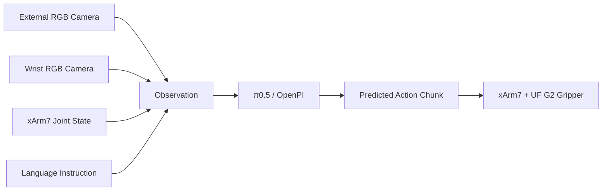
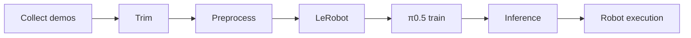

# π0.5 xArm7 Handwash Bottle Picking

<p align="center">
  <b>Real-robot Vision-Language-Action deployment with π0.5 on UFactory xArm7</b>
</p>

<p align="center">
  
  
  
  
  
</p>

<p align="center">
  
</p>

<p align="center">
  <i>Task progression: initial scene → approach → pre-grasp → grasp → lift → successful pickup.</i>
</p>

<p align="center">
  
</p>

<p align="center">
  <i>Language instruction: “Pick up the handwash bottle.”</i>
</p>

---

## Overview

This repository presents a complete real-robot pipeline for deploying **π0.5** on a **UFactory xArm7** for handwash-bottle picking. The system combines dual RGB observations, robot joint state, and a natural-language instruction to produce robot actions for the xArm7 and UF G2 gripper.

The project covers the full workflow from **demonstration collection** and **data preprocessing** to **LeRobot conversion**, **π0.5 inference**, and **real-robot execution**.

### Key Features

| Component | Details |
|---|---|
| VLA policy | π0.5 / OpenPI |
| Robot | UFactory xArm7 |
| Gripper | UF G2 |
| Cameras | 2 × Intel RealSense D435i |
| Middleware | ROS 2 Jazzy |
| Dataset format | LeRobot |
| Demonstrations | Approximately 100 real-robot demonstrations |
| Task | Pick up the handwash bottle |

---

## System Architecture



---

## Real-Robot Setup

<p align="center">
  
</p>

The setup uses an xArm7 with a UF G2 gripper and two Intel RealSense D435i cameras: one external camera and one wrist-mounted camera.

---

## Dataset and Workflow

Approximately **100 demonstrations** were collected for the handwash-bottle picking task and converted to LeRobot format.



The corresponding scripts are organized as follows:

| Stage | Script |
|---|---|
| Data collection | `data_collection/record_xarm_fresh_100.py` |
| Trimming | `data_processing/trim_xarm_fresh_100.py` |
| Preprocessing | `data_processing/preprocess_xarm_fresh_100.py` |
| LeRobot conversion | `data_processing/xarm_to_lerobot_fresh_100.py` |
| Real-robot inference | `inference/run_handwash_pick.py` |
| Inference-only test | `inference/xarm_pi05_live_inference_only.py` |
| Dry run | `tests/xarm_pi05_true_dryrun.py` |

More details are available in [docs/workflow.md](docs/workflow.md).

---

## Repository Structure

```text
pi0.5-xArm7-handwash-pick/
├── assets/
│   ├── handwash_pick_demo.gif
│   ├── handwash_task_montage.jpg
│   └── xarm7_handwash_setup.jpg
├── data_collection/
│   └── record_xarm_fresh_100.py
├── data_processing/
│   ├── preprocess_xarm_fresh_100.py
│   ├── trim_xarm_fresh_100.py
│   └── xarm_to_lerobot_fresh_100.py
├── docs/
│   ├── setup.md
│   └── workflow.md
├── inference/
│   ├── run_handwash_pick.py
│   └── xarm_pi05_live_inference_only.py
├── evaluation/
│   ├── README.md
│   ├── trials.csv
│   └── summarize_results.py
├── tests/
│   └── xarm_pi05_true_dryrun.py
├── .gitignore
├── README.md
└── requirements.txt
```

---

## Installation

### 1. Clone the repository

```bash
git clone https://github.com/KLochan/pi0.5-xArm7-handwash-pick.git
cd pi0.5-xArm7-handwash-pick
```

### 2. Install general Python dependencies

```bash
pip install -r requirements.txt
```

### 3. Source ROS 2 and the xArm workspace

```bash
source /opt/ros/jazzy/setup.bash
source ~/xarm_ws/install/setup.bash
```

This project also assumes that the following are already configured:

- ROS 2 Jazzy
- UFactory xArm ROS 2 packages
- Intel RealSense camera stack
- OpenPI / π0.5 environment
- `openpi_client`

See [docs/setup.md](docs/setup.md) for additional setup notes.

---

## Running the Project

### Real-robot execution

```bash
python3 inference/run_handwash_pick.py
```

### Inference-only check

```bash
python3 inference/xarm_pi05_live_inference_only.py
```

### Dry run

```bash
python3 tests/xarm_pi05_true_dryrun.py
```

> **Safety:** Before enabling robot motion, verify the workspace, emergency-stop access, joint limits, gripper state, camera streams, and predicted actions.

---

## Demo

<p align="center">
  
</p>

<p align="center">
  <b>Task:</b> “Pick up the handwash bottle.”
</p>

---


## Performance Benchmarks

The benchmark below is derived from a saved real-robot controller log on the RTX 5090 workstation. It contains **98 completed policy inference calls**.

### Verified π0.5 Inference Latency

| Metric | Verified value |
|---|---:|
| Policy inference calls | **98** |
| Median latency | **99.75 ms** |
| P95 latency | **104.33 ms** |
| P99 latency | **413.04 ms** |
| Minimum latency | **92.90 ms** |
| Raw mean latency | **203.82 ms** |
| Maximum latency | **10.308 s** |
| Calls below 1 s | **97 / 98** |
| Mean latency below 1 s | **99.66 ms** |
| Median latency below 1 s | **99.70 ms** |

Typical π0.5 policy inference was approximately **100 ms**. One **10.308 s** latency spike inflated the raw mean, so the **median** and **P95** are more representative of normal runtime behavior. The typical equivalent policy inference rate was therefore approximately **10 Hz**.

### Runtime Configuration

| Parameter | Value |
|---|---:|
| GPU | NVIDIA GeForce RTX 5090 |
| Demonstrations | ~100 |
| Dataset sampling rate | 6 Hz |
| Sampling interval | ~167 ms |
| Predicted action horizon | 15 steps |
| Robot controls | 7 arm joints + 1 gripper |
| Cameras | External + wrist Intel RealSense D435i |

### Verified Real-Robot Episode

A saved controller log confirms at least one complete physical **pick–lift–release** episode:

| Result | Verified value |
|---|---:|
| Successful completed episode | **1** |
| Lift target | **50 mm** |
| Achieved lift height | **67 mm** |
| Hold duration | **1 s** |
| Return to HOME | **Successful** |

A formal multi-trial success rate is not reported yet because the available log contains one fully completed episode and a subsequently started episode without a completion marker.

An evaluation template and summary script are provided in [evaluation/](evaluation/) for future fixed-trial experiments.

Run the summary after completing the trials:

```bash
python3 evaluation/summarize_results.py evaluation/trials.csv
```

## Repository Scope

This repository contains the integration and experimental pipeline developed for the xArm7 handwash-bottle task, including:

- real-robot demonstration recording,
- trajectory trimming and preprocessing,
- conversion to LeRobot format,
- π0.5 inference,
- xArm7 action execution, and
- dry-run / inference-only testing.

Large datasets, checkpoints, ROS bags, Hugging Face caches, and upstream third-party repositories are intentionally excluded.

---

## Roadmap

- [x] Collect real-robot demonstrations
- [x] Convert demonstrations to LeRobot format
- [x] Train / serve a π0.5 checkpoint
- [x] Run real-robot inference on xArm7
- [x] Add inference-only and dry-run validation
- [ ] Complete quantitative success-rate evaluation
- [x] Add latency and inference-time benchmark reporting
- [ ] Add action-caching experiments
- [ ] Explore reduced flow-matching inference steps
- [ ] Extend to multi-object manipulation tasks

---

## Acknowledgements

This project was carried out at **CINAPS Lab, Graduate School of System Informatics, Kobe University, Japan**.

This project builds on:

- **π0.5 / OpenPI** for the Vision-Language-Action policy and inference infrastructure
- **LeRobot** for robot-learning dataset tooling and representation
- **ROS 2** for middleware and robot communication
- **UFactory xArm7 / xArm ROS 2** for robot control
- **Intel RealSense** for visual observations

These third-party frameworks, drivers, and hardware platforms remain subject to their respective licenses and terms.
