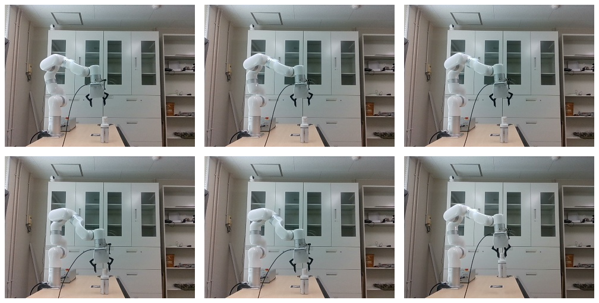
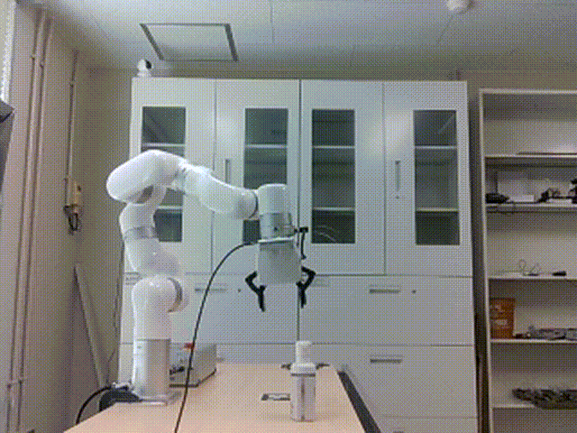
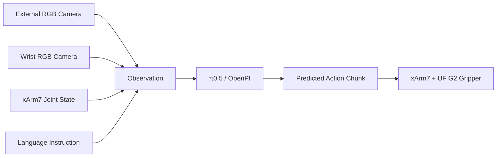
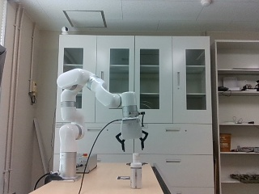
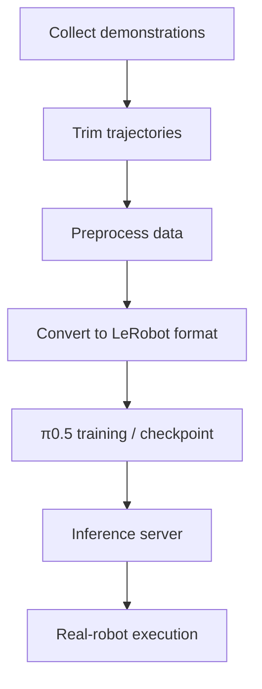

# π0.5 xArm7 Handwash Bottle Picking

<p align="center">
  <b>Real-robot Vision-Language-Action deployment with π0.5 on UFactory xArm7</b>
</p>

<p align="center">
  
  
  
  
  
</p>

<p align="center">
  
</p>

<p align="center">
  <i>Task progression: initial scene → approach → pre-grasp → grasp → lift → successful pickup.</i>
</p>

<p align="center">
  
</p>

<p align="center">
  <i>Language instruction: “Pick up the handwash bottle.”</i>
</p>

---

## Overview

This repository presents a complete real-robot pipeline for deploying **π0.5** on a **UFactory xArm7** for handwash-bottle picking. The system combines dual RGB observations, robot joint state, and a natural-language instruction to produce robot actions for the xArm7 and UF G2 gripper.

The project covers the full workflow from **demonstration collection** and **data preprocessing** to **LeRobot conversion**, **π0.5 inference**, and **real-robot execution**.

### Key Features

| Component | Details |
|---|---|
| VLA policy | π0.5 / OpenPI |
| Robot | UFactory xArm7 |
| Gripper | UF G2 |
| Cameras | 2 × Intel RealSense D435i |
| Middleware | ROS 2 Jazzy |
| Dataset format | LeRobot |
| Demonstrations | Approximately 100 real-robot demonstrations |
| Task | Pick up the handwash bottle |

---

## System Architecture



---

## Real-Robot Setup

<p align="center">
  
</p>

The setup uses an xArm7 with a UF G2 gripper and two Intel RealSense D435i cameras: one external camera and one wrist-mounted camera.

---

## Dataset and Workflow

Approximately **100 demonstrations** were collected for the handwash-bottle picking task and converted to LeRobot format.



The corresponding scripts are organized as follows:

| Stage | Script |
|---|---|
| Data collection | `data_collection/record_xarm_fresh_100.py` |
| Trimming | `data_processing/trim_xarm_fresh_100.py` |
| Preprocessing | `data_processing/preprocess_xarm_fresh_100.py` |
| LeRobot conversion | `data_processing/xarm_to_lerobot_fresh_100.py` |
| Real-robot inference | `inference/run_handwash_pick.py` |
| Inference-only test | `inference/xarm_pi05_live_inference_only.py` |
| Dry run | `tests/xarm_pi05_true_dryrun.py` |

More details are available in [docs/workflow.md](docs/workflow.md).

---

## Repository Structure

```text
pi0.5-xArm7-handwash-pick/
├── assets/
│   ├── handwash_pick_demo.gif
│   ├── handwash_task_montage.jpg
│   └── xarm7_handwash_setup.jpg
├── data_collection/
│   └── record_xarm_fresh_100.py
├── data_processing/
│   ├── preprocess_xarm_fresh_100.py
│   ├── trim_xarm_fresh_100.py
│   └── xarm_to_lerobot_fresh_100.py
├── docs/
│   ├── setup.md
│   └── workflow.md
├── inference/
│   ├── run_handwash_pick.py
│   └── xarm_pi05_live_inference_only.py
├── tests/
│   └── xarm_pi05_true_dryrun.py
├── .gitignore
├── README.md
└── requirements.txt
```

---

## Installation

### 1. Clone the repository

```bash
git clone https://github.com/KLochan/pi0.5-xArm7-handwash-pick.git
cd pi0.5-xArm7-handwash-pick
```

### 2. Install general Python dependencies

```bash
pip install -r requirements.txt
```

### 3. Source ROS 2 and the xArm workspace

```bash
source /opt/ros/jazzy/setup.bash
source ~/xarm_ws/install/setup.bash
```

This project also assumes that the following are already configured:

- ROS 2 Jazzy
- UFactory xArm ROS 2 packages
- Intel RealSense camera stack
- OpenPI / π0.5 environment
- `openpi_client`

See [docs/setup.md](docs/setup.md) for additional setup notes.

---

## Running the Project

### Real-robot execution

```bash
python3 inference/run_handwash_pick.py
```

### Inference-only check

```bash
python3 inference/xarm_pi05_live_inference_only.py
```

### Dry run

```bash
python3 tests/xarm_pi05_true_dryrun.py
```

> **Safety:** Before enabling robot motion, verify the workspace, emergency-stop access, joint limits, gripper state, camera streams, and predicted actions.

---

## Demo

<p align="center">
  
</p>

<p align="center">
  <b>Task:</b> “Pick up the handwash bottle.”
</p>

---


## Performance Benchmarks

The values below summarize measurements already observed during development. They are reported as implementation benchmarks rather than a formal task-success evaluation.

### Inference Latency

| Platform | Mean Inference Time | Approx. Rate |
|---|---:|---:|
| RTX 5080 Laptop GPU | ~253 ms | ~4.0 Hz |
| RTX 5090 Workstation GPU | ~62.8 ms | ~15.9 Hz |

The RTX 5090 workstation substantially reduced π0.5 inference latency compared with the laptop platform.

### Runtime Configuration

| Parameter | Value |
|---|---:|
| Demonstrations | ~100 |
| Dataset sampling rate | 6 Hz |
| Sampling interval | ~167 ms |
| Predicted action horizon | 15 steps |
| Robot controls | 7 arm joints + 1 gripper |
| Cameras | External + wrist Intel RealSense D435i |

### Additional Timing Observation

A separate multi-sample inference test recorded:

```text
5-sample inference time: 0.0869 s
```

### Real-Robot Evaluation Status

The current system has demonstrated successful:

- bottle approach,
- grasp execution,
- object lift,
- and closed-loop xArm7 action execution.

A formal success-rate study has not yet been completed. Future evaluation will report fixed-trial success rate, end-to-end task time, policy-call count, and minimum / mean / maximum inference latency.

## Repository Scope

This repository contains the integration and experimental pipeline developed for the xArm7 handwash-bottle task, including:

- real-robot demonstration recording,
- trajectory trimming and preprocessing,
- conversion to LeRobot format,
- π0.5 inference,
- xArm7 action execution, and
- dry-run / inference-only testing.

Large datasets, checkpoints, ROS bags, Hugging Face caches, and upstream third-party repositories are intentionally excluded.

---

## Roadmap

- [x] Collect real-robot demonstrations
- [x] Convert demonstrations to LeRobot format
- [x] Train / serve a π0.5 checkpoint
- [x] Run real-robot inference on xArm7
- [x] Add inference-only and dry-run validation
- [ ] Add quantitative success-rate evaluation
- [ ] Add latency and inference-time benchmarks
- [ ] Add action-caching experiments
- [ ] Explore reduced flow-matching inference steps
- [ ] Extend to multi-object manipulation tasks

---

## Acknowledgements

This project builds on:

- **π0.5 / OpenPI** for the Vision-Language-Action policy and inference infrastructure
- **LeRobot** for robot-learning dataset tooling and representation
- **ROS 2** for middleware and robot communication
- **UFactory xArm7 / xArm ROS 2** for robot control
- **Intel RealSense** for visual observations

These third-party frameworks, drivers, and hardware platforms remain subject to their respective licenses and terms.

---

## Citation

If you use this repository in academic work, please cite the relevant upstream **π0.5 / OpenPI** and **LeRobot** publications or repositories in addition to referencing this implementation.

A project-specific BibTeX entry can be added here if this work is released with an associated publication.
